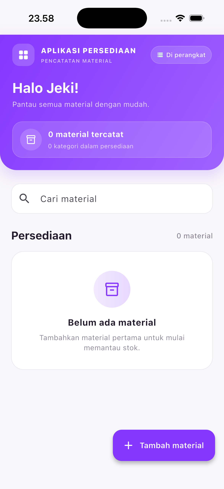
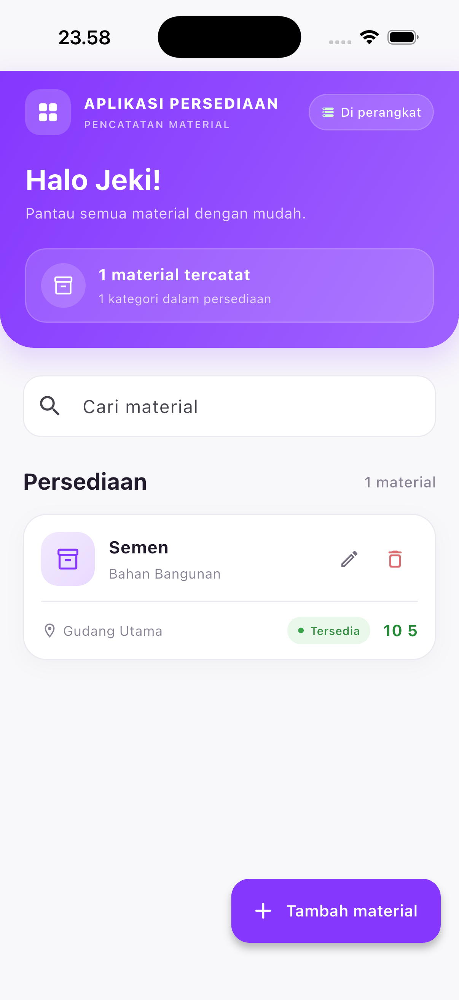

# Supply_App 

## Deskripsi Aplikasi

Aplikasi satu halaman untuk mencatat dan memantau persediaan material. Data material disimpan secara lokal menggunakan SQLite.

## Fitur Aplikasi

- Tambah, lihat, ubah, dan hapus data material.
- Cari material berdasarkan nama, kategori, atau lokasi penyimpanan.
- Catat jumlah, satuan, kategori, dan lokasi setiap material.
- Lihat jumlah material, kategori, dan status stok.

## Teknologi & Library

- Flutter dan Dart (`^3.12.1`).
- GetX (`^4.7.3`) untuk pengelolaan status, navigasi, dan dependensi.
- sqflite (`^2.4.6`) untuk penyimpanan SQLite lokal.
- path (`^1.9.1`) untuk menyusun lokasi berkas basis data.
- cupertino_icons (`^1.0.8`) tercantum sebagai dependensi ikon.

## Cara Menjalankan Aplikasi

1. Pasang Flutter dengan Dart yang memenuhi batas SDK di `pubspec.yaml`.
2. Siapkan perangkat atau emulator yang mendukung Flutter dan sqflite.
3. Buka terminal pada direktori utama proyek, lalu pasang dependensi:

   ```sh
   flutter pub get
   ```

4. Jalankan aplikasi pada perangkat atau emulator yang tersedia:

   ```sh
   flutter run
   ```

## Referensi Visual

Gambar berikut menjadi acuan visual aplikasi:


## Dokumentasi UI Aplikasi

Berikut dokumentasi tampilan aplikasi saat persediaan masih kosong dan saat material sudah tercatat:

### Persediaan Kosong



### Persediaan Berisi Material


